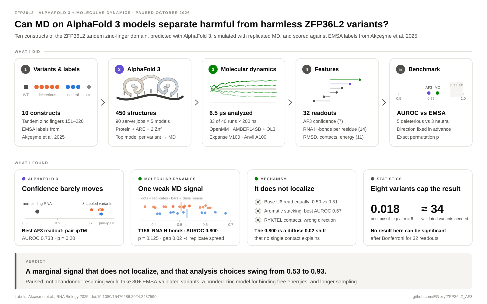
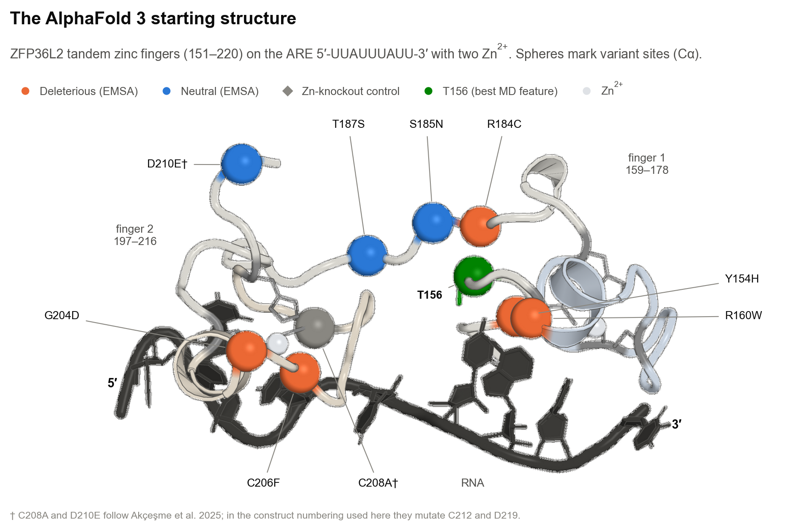

# ZFP36L2 variants: AlphaFold 3 + molecular dynamics

Can molecular dynamics run on AlphaFold 3 models tell harmful ZFP36L2 variants from harmless ones? This repository holds the write-up, data and code for a computational project that put that question to eight experimentally labeled missense variants in the ZFP36L2 tandem zinc-finger domain.

**Status: paused (October 2026).** MD found one readout that edges past AlphaFold 3's own confidence; however, it is too small to be significant with eight variants, and it does not point to any specific contact. The sections below explain what I did, what I found, and why I stopped.

<p align="center">
  
</p>

## Summary

ZFP36L2 is an RNA-binding protein that sends messenger RNAs to be degraded. Two CCCH zinc fingers grip AU-rich elements (AREs) in the 3′ untranslated region of its targets, and the protein then recruits the decay machinery. Akçeşme et al. (2025) predicted which single-nucleotide variants in that domain should be damaging and tested eight of them by EMSA: five lost RNA binding, three did not. I asked whether physics could recover those labels from structure alone. I predicted each variant–RNA complex with AlphaFold 3, simulated it with replicated all-atom MD, and scored 32 structural readouts against the EMSA labels.

- **AlphaFold 3 is almost equally confident about every variant.** Interface confidence (pair-ipTM) spans 0.71 to 0.78, and its best readout separates the classes with an AUROC of 0.733.
- **MD adds one weak signal.** Across 33 replicated 200 ns trajectories (6.5 µs), the number of hydrogen bonds between Thr156 and the RNA ranks the variants with an AUROC of 0.800. With five deleterious and three neutral variants, that is a one-sided p of 0.125.
- **The signal does not localize.** T156 reads the same base (U6) in both classes, aromatic stacking does not separate them, and contacts at the RYKTEL motif move in the wrong direction.
- **Eight variants cap what any method can show.** Even a perfect ranking would give p = 0.018, and defensible changes to the analysis swing the AUROC between 0.53 and 0.93.

I paused here rather than stretch a marginal number into a mechanism. Everything needed to pick the project back up is in this repository: inputs, analysis code, and the exact numbers behind every figure.

## The system

<p align="center">
  
</p>

| Variant | EMSA label | Location | AF3 pair-ipTM | T156–RNA H-bonds per frame | MD runs |
|:--|:--|:--|--:|--:|--:|
| WT | reference | | 0.765 | 0.601 | 3 |
| Y154H | deleterious | RYKTEL lead-in to finger 1 | 0.775 | 0.543 | 4 |
| R160W | deleterious | finger 1 | 0.756 | 0.501 | 4 |
| R184C | deleterious | linker | 0.758 | 0.463 | 3 |
| G204D | deleterious | finger 2 | 0.767 | 0.508 | 4 |
| C206F | deleterious | finger 2, zinc ligand | 0.710 | 0.514 | 3 |
| S185N | neutral | linker | 0.771 | 0.523 | 3 |
| T187S | neutral | linker | 0.762 | 0.532 | 4 |
| D210E† | neutral | C-terminal tail | 0.769 | 0.531 | 3 |
| C208A† | zinc-knockout control, not scored | finger 2, zinc ligand | 0.752 | 0.540 | 2 |

AF3 values are means of 40 models (8 seeds × 5). H-bond values are replicate means; WT and the control are shown for reference but never scored.
† Names follow Akçeşme et al. 2025. In the construct numbering used here, the AF3 jobs mutate D219 and C212 ([naming notes](#naming-notes)).

## What I did

1. **AlphaFold 3.** I predicted the domain (residues 151–220) with the ARE 5′-UUAUUUAUU-3′ and two Zn²⁺ for 12 constructs on AlphaFold Server: 90 jobs and 450 models. → [AlphaFold 3 results](docs/01_AF3_results.md)
2. **Molecular dynamics.** I started from the top-ranked model per variant and ran OpenMM 8.2 with AMBER ff14SB, RNA.OL3 and TIP3P in 0.15 M NaCl at 310 K. Each variant got two to four independent 200 ns replicates on SDSC Expanse (V100) and Purdue Anvil (A100); 33 of 40 runs finished, giving 6.5 µs. → [MD results](docs/02_MD_results.md)
3. **Benchmark.** I scored 32 readouts against the EMSA labels: 7 AF3 confidence metrics, 14 per-residue RNA hydrogen-bond counts, and 11 RMSD, contact and energy metrics. Each was averaged over replicates, its direction was fixed in advance, and it was scored as AUROC with an exact permutation p. → [Conclusions](docs/03_conclusions.md)

## Results at a glance

| Readout | AUROC | one-sided p | Where |
|:--|--:|--:|:--|
| AF3 pair-ipTM (best AF3 readout) | 0.733 | 0.196 | [AF3 results](docs/01_AF3_results.md) |
| MD T156–RNA hydrogen bonds (best MD readout) | 0.800 | 0.125 | [MD results](docs/02_MD_results.md#the-best-signal-t156rna-hydrogen-bonds) |
| MD bulk readouts: RMSD, contacts, Q-score, MM-GBSA | 0.20–0.40 | | [MD results](docs/02_MD_results.md#the-screen-32-readouts) |
| A perfect ranking of these eight variants | 1.000 | 0.018 | [Conclusions](docs/03_conclusions.md#eight-variants-cannot-carry-a-significant-result) |

## Why the project is paused

The goal was never just a number above 0.5. It was a mechanism: a contact that deleterious variants break and neutral ones keep, visible in MD but invisible to AlphaFold 3. To be fair, the T156 readout is real in the narrow sense: it survives a standardized re-analysis and dropping each variant's weakest replicate. Yet its class gap (0.02 H-bonds per frame) is smaller than the error bar of a single trajectory, it localizes to no specific contact, and no result at this sample size can survive correction for 32 readouts. The point, then, is not that MD failed. It is that eight labeled variants cannot settle the question, and more nanoseconds would not change that; more EMSA-validated variants would.

## Read the write-up

1. [AlphaFold 3 results](docs/01_AF3_results.md): inputs, confidence per variant, the non-binding RNA control, and two traps in AF3 summary metrics.
2. [Molecular dynamics results](docs/02_MD_results.md): protocol, sampling, the 32-readout screen, the T156 signal, convergence, and the mechanism checks.
3. [Conclusions](docs/03_conclusions.md): the n = 8 ceiling, how analysis choices move the answer, lessons, and what would justify resuming.

## Repository map

| Path | Contents |
|:--|:--|
| `docs/` | The three write-up pages |
| `figures/` | Every figure as editable SVG plus PNG; `src/` rebuilds them, `data/` holds derived CSVs and `tables.md` (the numbers behind each figure) |
| `Data/` | AlphaFold Server outputs: 12 constructs × 5–8 seeds (models, confidences, MSAs, templates) |
| `results/`, `analysis/` | AF3 metric tables, including the non-binding RNA control (`analysis/interface_metrics_models.csv`) |
| `anvil_md/` | Production MD driver (`run_md_anvil.py`), structure prep, HPC submission scripts, MD starting models (`best_models/`) |
| `expanse_md_analysis/` | MD analysis scripts, per-trajectory metrics, AUROC tables, and the working notes from each stage of the analysis |
| `MD_GCP_Pipeline_Consolidated/`, `md_simulation/`, `AlphaFold/` | Early pipeline development and sub-nanosecond smoke tests; not the basis of any result |

The MD trajectories (about 23 GB of DCD files) are too large for GitHub and are not included. The per-trajectory summaries and the per-frame T156 series that the figures need are included.

## Reproducing the figures

```bash
python -m venv .venv
.venv/bin/pip install numpy pandas matplotlib tabulate
.venv/bin/python figures/src/af3_metrics.py      # per-model AF3 metrics from Data/
.venv/bin/python figures/src/make_figures.py     # every data figure + figures/data/tables.md
```

Two inputs come from resources outside the repository, and their outputs are committed. `figures/src/extract_t156_series.py` needs the trajectories and mdtraj. `figures/src/render_structure.py` needs PyMOL. `fig0_pipeline.svg` and `figA1_construct_map.svg` are drawn by hand; edit them directly.

## Naming notes

- **"F156" is Thr156.** The analysis code labels residue 6 of the construct as F156; the sequence there is R-Y-K-**T**-E-L, the RYKTEL motif that starts finger 1. Five other per-residue columns carry similarly shifted names. The figures and tables use the residue that is actually present ([full mapping](docs/02_MD_results.md#naming-in-the-analysis-code)).
- **C208A and D210E** follow Akçeşme et al. 2025. In the numbering used here (construct residue + 150), the AF3 jobs mutate C212 (a finger-2 zinc ligand) and D219 (the C-terminal tail). The MD code calls the control C212A.

## Acknowledgments

- EMSA labels: Akçeşme B, Hekimoğlu H, Chirasani VR, İş Ş, Atmaca HN, Waldern JM, Ramos SBV. Identification of deleterious non-synonymous single nucleotide polymorphisms in the mRNA decay activator ZFP36L2. *RNA Biology* 22(1):1–15 (2025). [doi:10.1080/15476286.2024.2437590](https://doi.org/10.1080/15476286.2024.2437590)
- Thanks to Dr. Silvia B. V. Ramos for discussions throughout the project.
- Simulations ran on SDSC Expanse and Purdue Anvil.
- AlphaFold 3 predictions were made with AlphaFold Server and are subject to the AlphaFold Server Output Terms of Use; a copy sits in each `Data/` job folder.
