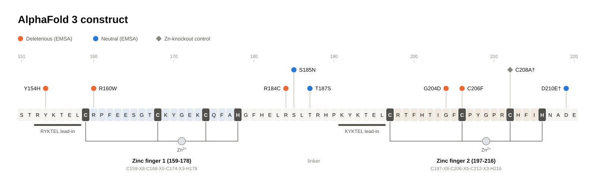
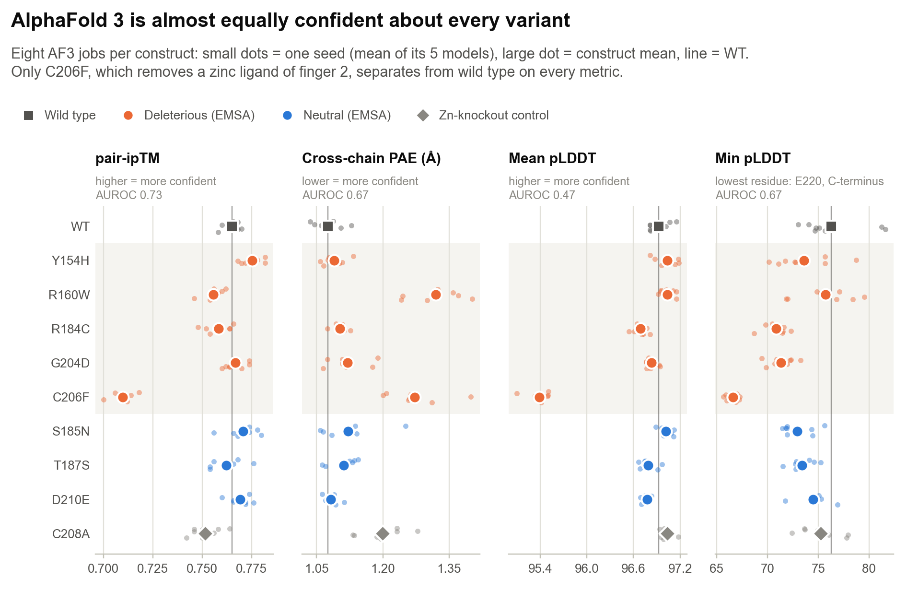
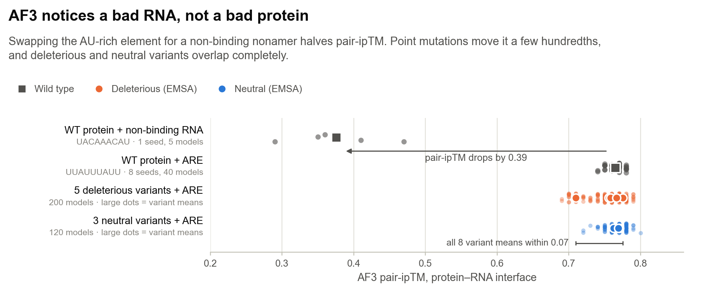

# 1 · AlphaFold 3 results

[← Back to overview](../README.md) · [MD results →](02_MD_results.md)

AlphaFold 3 plays two roles in this project. It supplies the starting structure for every MD run, and its confidence scores are the baseline MD has to beat. If a structure predictor could already rank the variants, there would be little reason to spend microseconds of simulation on them. This page asks how much AF3 alone can say.

## Inputs

  

- **Protein:** ZFP36L2 residues 151–220 (NP_008818.3), the tandem zinc-finger domain. Each finger coordinates one zinc through a C-X8-C-X5-C-X3-H motif.
- **RNA:** 5′-UUAUUUAUU-3′, the AU-rich nonamer that the same domain (TIS11d) binds in the NMR structure 1RGO (Hudson et al. 2004).
- **Ions:** two Zn²⁺.
- **Server settings:** AlphaFold Server with templates on; 8 seeds per construct (5 for the two constructs that never reached MD), 5 ranked models per seed.

| Construct | Mutation in this construct | Role | Seeds | MD |
|:--|:--|:--|--:|:--|
| WT | none | reference | 8 | yes |
| Y154H | Y154H | deleterious (EMSA) | 8 | yes |
| R160W | R160W | deleterious (EMSA) | 8 | yes |
| R184C | R184C | deleterious (EMSA) | 8 | yes |
| G204D | G204D | deleterious (EMSA) | 8 | yes |
| C206F | C206F, a finger-2 zinc ligand | deleterious (EMSA) | 8 | yes |
| S185N | S185N | neutral (EMSA) | 8 | yes |
| T187S | T187S | neutral (EMSA) | 8 | yes |
| D210E | D219E† | neutral (EMSA) | 8 | yes |
| C208A | C212A†, a finger-2 zinc ligand | zinc-knockout control | 8 | yes |
| R160E | R160E | charge reversal at R160, staged | 5 | no |
| H212A | H216A†, a finger-2 zinc ligand | zinc-ligand control, staged | 5 | no |

† The construct names come from the project's sources; the mutation column is what each AF3 job actually contains, read from its input sequence (residue = construct position + 150).

In total: 90 server jobs and 450 models. The top-ranked model per variant, by AF3 ranking score across all eight seeds, became the MD starting structure (`anvil_md/best_models/best_model_selection.csv`). On Anvil, a job-script error started every replicate from the wild-type structure instead; see [MD results](02_MD_results.md#what-was-actually-simulated).

## Confidence barely moves

  

AF3 builds nearly the same complex for every variant, with nearly the same confidence:

- **pair-ipTM** (confidence in the protein–RNA interface) spans 0.710–0.775 across all ten constructs; WT sits at 0.765.
- **Mean pLDDT** stays between 95.4 and 97.0.
- **C206F is the one clear outlier.** It replaces a zinc ligand of finger 2 and is lower on every metric: pair-ipTM 0.710, pLDDT 95.4, min pLDDT 66.6.
- **R160W raises cross-chain PAE** (1.32 Å against 1.08 Å for WT) without moving pair-ipTM much.
- **The zinc-knockout control barely registers** (pair-ipTM 0.752). I supplied two Zn²⁺ ions, so AF3 placed both and folded finger 2 even with one of its four ligands gone. A designed loss-of-function control looks almost wild-type to the predictor.

As classifiers of the eight labeled variants (5 deleterious vs 3 neutral, construct means over all 40 models):

| AF3 readout | Direction scored as deleterious | AUROC | one-sided p |
|:--|:--|--:|--:|
| pair-ipTM | lower | 0.733 | 0.196 |
| cross-chain PAE | higher | 0.667 | 0.286 |
| min pLDDT | lower | 0.667 | 0.286 |
| mean pLDDT | lower | 0.467 | 0.607 |

## AF3 notices a bad RNA, not a bad protein

  

To check that the confidence head can respond to binding at all, I ran the WT domain with 5′-UACAAACAU-3′, a nonamer listed as non-binding in the project's RNA probe notes (one seed, five models). pair-ipTM fell from 0.765 to 0.376. That drop is about six times the spread across all eight labeled variants (0.065). AF3 is therefore not blind to binding; it is blind to point mutations that weaken binding. That fits what it is trained to do: predict what a complex looks like, not how stable it is.

## Two traps in AF3 summary metrics

1. **"Min pLDDT" measures the floppy C-terminus.** The lowest-confidence residue is E220, the last residue of the construct, in 449 of 450 models. The metric reports how disordered the tail is, not anything about RNA binding. The D210E construct (D219E in this numbering) mutates the residue right next to it.
2. **How models are pooled changes the answer.** Averaging all 40 models per variant gives pair-ipTM an AUROC of 0.733. Using only each seed's top-ranked model gives 0.633. For min pLDDT the same switch moves the AUROC from 0.667 to 0.933, a nominally significant value that comes from the terminal residue. [Conclusions](03_conclusions.md#reasonable-analysis-choices-move-the-answer) returns to this point.

## Takeaways

- On these eight variants AF3 confidence is a weak signal: the best readout reaches an AUROC of 0.733 (p = 0.20), and much of the separation comes from C206F, the one mutation that removes a zinc ligand.
- AF3 clearly responds to a non-binding RNA. Point-mutation effects on binding are mostly outside what its confidence scores report.
- AF3's contribution here is the structure: a plausible bound complex for every variant, which is what the MD runs start from.

## Files

| Path | Contents |
|:--|:--|
| `Data/<construct>/<job>/` | Raw AlphaFold Server outputs: `model_*.cif`, `summary_confidences_*.json`, `full_data_*.json`, MSAs, templates, terms of use |
| `figures/data/af3_per_model.csv` | Per-model metrics behind the figures (`figures/src/af3_metrics.py`) |
| `results/variant_avg*.csv`, `results/variant_vs_wt*.csv` | Earlier summary and Welch-test tables (`analyze_best_models.py`) |
| `analysis/interface_metrics_models.csv` | Earlier per-model interface analysis, including the non-binding RNA control |
| `anvil_md/best_models/` | The model used to start MD for each variant |

## References

- Abramson J, et al. Accurate structure prediction of biomolecular interactions with AlphaFold 3. *Nature* 630, 493–500 (2024).
- Hudson BP, Martinez-Yamout MA, Dyson HJ, Wright PE. Recognition of the mRNA AU-rich element by the zinc finger domain of TIS11d. *Nat Struct Mol Biol* 11, 257–264 (2004).
- Akçeşme B, et al. Identification of deleterious non-synonymous single nucleotide polymorphisms in the mRNA decay activator ZFP36L2. *RNA Biology* 22(1):1–15 (2025).
