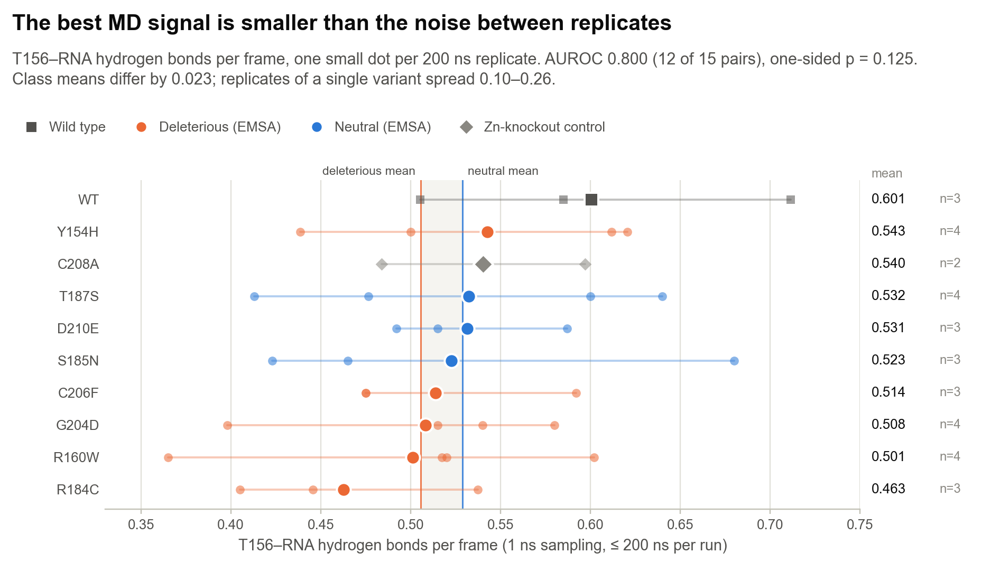
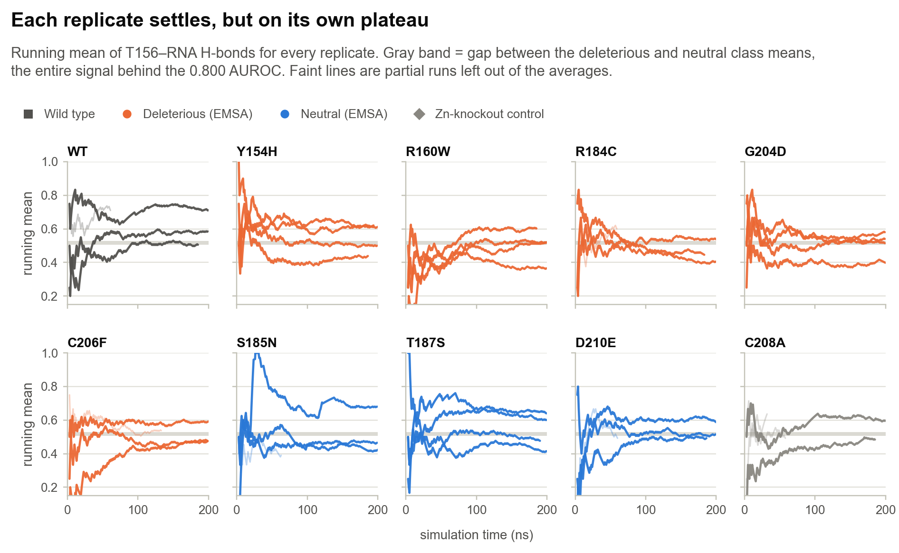
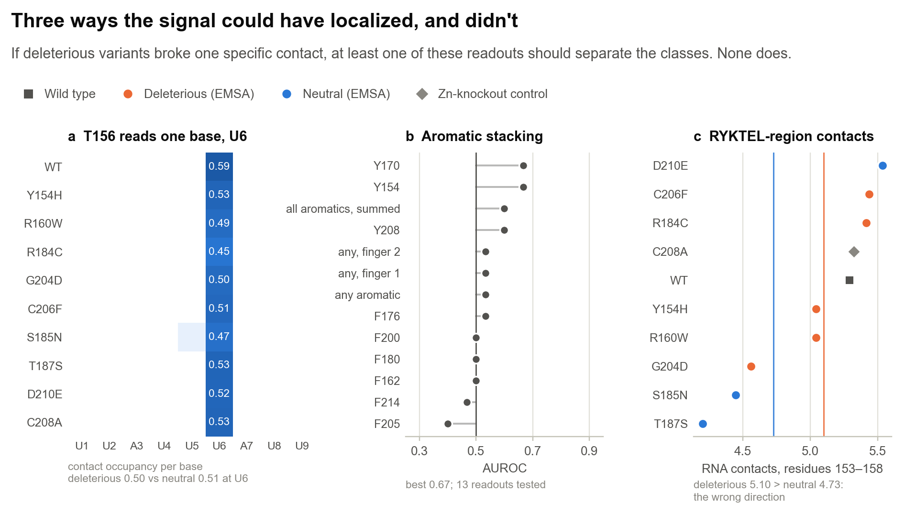

# 2 · Molecular dynamics results

[← AlphaFold 3 results](01_AF3_results.md) · [Back to overview](../README.md) · [Conclusions →](03_conclusions.md)

AlphaFold 3 returns one static complex per variant. A point mutation that weakens RNA binding might not change that snapshot, but it should change how the complex behaves over time: which contacts hold, which break, how often. That was the bet behind the MD: run every labeled variant long enough, and more than once, to see a difference AF3 cannot. This page reports what the simulations showed and how hard I looked for a mechanism behind it.

## Protocol

| Step | Setting |
|:--|:--|
| Starting structure | Top-ranked AF3 model per variant (highest ranking score across 8 seeds × 5 models) |
| Engine | OpenMM 8.2 on CUDA (`anvil_md/run_md_anvil.py`) |
| Force field | AMBER ff14SB (protein), RNA.OL3, TIP3P water |
| System | 1.2 nm padding, 0.15 M NaCl; about 23,000–25,000 atoms |
| Zinc | Harmonic Zn–S restraints to each cysteine within 0.35 nm of a Zn²⁺ (k = 200 kJ mol⁻¹ nm⁻², r₀ from the AF3 model); histidine ligands unrestrained |
| Equilibration | Energy minimization; 0.2 ns NVT with heavy-atom restraints (1000 kJ mol⁻¹ nm⁻²); 0.5 ns NPT (100 kJ mol⁻¹ nm⁻²) |
| Production | NPT, 310 K, 1 atm; Langevin integrator (1 ps⁻¹), Monte Carlo barostat; 2 fs step with H-bond constraints; PME, 1.0 nm cutoff; frames every 100 ps |
| Sampling | 2–4 independent 200 ns replicates per variant; runs of at least 180 ns are used, capped at 200 ns |
| Hardware | SDSC Expanse (V100) and Purdue Anvil (A100) |

  

Forty production runs were launched and 33 reached at least 180 ns: 6.5 µs of analyzed sampling, with every variant covered by two to four replicates. The seven partial runs (33–134 ns) are excluded from every average.

## How readouts are scored

- **AUROC** is the probability that a randomly chosen deleterious variant looks more damaged than a randomly chosen neutral one. 0.5 is chance and 1.0 is perfect separation.
- **Direction is fixed in advance.** For example, fewer RNA hydrogen bonds counts as more damaged. Values below 0.5 mean the readout leaned the wrong way; I did not flip them.
- **Replicates are averaged** per variant before scoring, so each variant contributes one number.
- **Five deleterious against three neutral** variants gives 15 pairs, so AUROC moves in steps of 1/15. P-values are exact one-sided Mann–Whitney tests over the 56 possible rankings.
- **The C208A zinc-knockout control is not scored.** It removes a zinc ligand by design and is not one of the EMSA-labeled variants.

## The screen: 32 readouts

  

- **One MD readout beats AF3:** hydrogen bonds between Thr156 and the RNA, AUROC 0.867 in the original multi-replicate pipeline and 0.800 after the standardized re-analysis below. AF3's best, pair-ipTM, is 0.733.
- **Most per-residue hydrogen-bond counts sit at 0.4–0.67**, inside the range chance produces with 15 pairs.
- **Bulk readouts do not separate the classes.** RMSD, contact counts, the native-contact Q-score, and RMSF all fall at 0.20–0.40. Several lean the wrong way; finger-1 RMSD reaches 0.200. With a 9-nt RNA, neutral variants shift and re-register the RNA about as much as deleterious ones.
- **MM-GBSA with zinc stripped is not physical.** Removing the zinc to fit a standard implicit-solvent model gives positive interaction energies around +12,000 kJ/mol and an AUROC of 0.400. A real free-energy estimate needs a bonded zinc model, such as ZAFF or MCPB.py.
- **Nothing reaches p < 0.05**, which would need 14 of 15 pairs (AUROC ≥ 0.933).

## The best signal: T156–RNA hydrogen bonds

T156 is the threonine of the RYKTEL motif that leads into finger 1. In the TIS11d structure, residues of this motif contact the RNA bases (Hudson et al. 2004). The analysis code calls this residue F156; see the [naming notes](#naming-in-the-analysis-code).

  

I re-ran the T156 analysis with one consistent protocol: 1 ns sampling, only runs of at least 180 ns, a 200 ns cap, and the whole window kept.

| | Value |
|:--|:--|
| AUROC (5 deleterious vs 3 neutral) | 0.800, 12 of 15 pairs |
| One-sided exact p | 0.125 |
| AUROC after dropping each variant's lowest replicate | 0.800 |
| Class means, H-bonds per frame | deleterious 0.506 · neutral 0.529 (gap 0.023) |
| Spread between replicates of one variant | 0.10–0.26 |
| Blocking standard error of a single run | 0.034–0.102 (median 0.042) |
| Misordered deleterious variant | Y154H (0.543, above all three neutrals) |

The ranking is stable under the checks I could run, but the effect is tiny. The gap between class means is about half the error bar of one trajectory, and four deleterious variants separate from the neutrals while Y154H does not. Y154H mutates the tyrosine of the same RYKTEL motif, so it may damage binding in a way that leaves T156's own contact intact. That is a reasonable hypothesis; the data here cannot test it.

### Each replicate settles, on its own plateau

  

Within a run, the running mean flattens within 50–100 ns, and first-half and second-half means differ by a median of only 0.046. Between runs of the same variant, the plateaus differ by up to 0.26, ten times the class gap. The 9-nt RNA can sit on the protein in more than one register, and each replicate commits to one. Longer runs reduce noise within a run; they do nothing about this spread between runs, which only more replicates, or more variants, can average out.

## Looking for a mechanism

A classifier score is only interesting here if it points to a mechanism: one contact that deleterious variants lose and neutral ones keep. I tested the three most plausible ones.

  

1. **Base reading (panel a).** T156 contacts exactly one base, U6, in every variant. Its occupancy is the same in both classes (0.50 deleterious, 0.51 neutral), so the AUROC signal is not a lost base contact.
2. **Aromatic stacking (panel b).** Uracil stacking on aromatic side chains is the textbook way these fingers read RNA. I scored stacking geometry for all nine aromatic residues and four combined readouts. The best is 0.667 (Y154, Y170) and most sit near 0.5. Stacking also flips between 0 and about 0.85 across replicates of the same variant, which makes it register noise rather than a variant effect.
3. **Propagation through the RYKTEL region (panel c).** If distal mutations act by loosening the motif, RNA contacts of residues 153–158 should drop in deleterious variants. They do the opposite: 5.10 in deleterious variants against 4.73 in neutrals, and the two lowest are the neutrals T187S and S185N. Contacts next to each mutation barely change either.

Taken together, the 0.800 is a diffuse shift of 0.02 hydrogen bonds per frame that no single contact explains.

## Caveats

- **Short equilibration and production.** Equilibration was 0.7 ns of restrained dynamics, and the first 50 ns of production are partly relaxation from the AF3 pose. Akçeşme et al. used 3 × 1 µs runs (GROMACS, AMBER99SB) started from homology models; I ran 2–4 × 200 ns per variant from AF3 models, including the three neutral variants.
- **Zinc is restrained, not modeled.** Zn–Cys harmonic restraints keep the fingers intact but cannot describe how a mutation strains zinc coordination. This matters most for C206F and the C208A control.
- **Four trajectories start late.** For four Expanse runs (WT, Y154H, R184C, C208A), a restart without `--resume` overwrote the first ~130 ns of the trajectory file. The checkpoints reached 400 ns, and the analyzed 200 ns for these four runs begin about 130 ns into the simulation.
- **A 9-nt RNA is short.** It re-binds in shifted registers, which inflates differences between replicates. A longer ARE would give the fingers a fixed register but cost more sampling.

## Naming in the analysis code

The per-residue hydrogen-bond columns in `expanse_md_analysis/` were named from a residue list that does not match the construct sequence at six positions. The data are computed at the right positions; only the labels are wrong. The figures use the residue that is actually there.

| Column in the analysis CSVs | Construct position | Actual residue |
|:--|--:|:--|
| `hbond_RNA_F156` | 6 | **T156** (RYKTEL) |
| `hbond_RNA_H170` | 20 | Y170 |
| `hbond_RNA_R171` | 21 | G171 |
| `hbond_RNA_R200` | 50 | F200 |
| `hbond_RNA_C208` | 58 | Y208 |
| `hbond_RNA_D210` | 60 | P210 |

The variant called C212A in the MD code is the C208A control, and the D210E construct carries D219E (see [AF3 results](01_AF3_results.md#inputs)).

## Files

| Path | Contents |
|:--|:--|
| `anvil_md/run_md_anvil.py` | Production driver: solvation, restraints, equilibration, checkpointed production |
| `anvil_md/clean_af3_structures.py`, `select_best_models.py` | AF3 → MD structure preparation and model selection |
| `anvil_md/*.sh`, `anvil_md/expanse/` | SLURM submission scripts for Anvil and Expanse |
| `expanse_md_analysis/multi_replicate_auroc_v2.py` | 32-readout screen (`multi_replicate_all_metrics.csv`, `auroc_no_c212a.csv`) |
| `expanse_md_analysis/diagnostic_f156_convergence.py` | Standardized T156 re-analysis (`diagnostic_f156_convergence.csv`) |
| `expanse_md_analysis/compute_stacking_metrics.py`, `stacking_geometry.py` | Aromatic stacking geometry (tested by `test_stacking_geometry.py`) |
| `expanse_md_analysis/analyze_t156_mechanism.py` | Base reading and RYKTEL propagation (`t156_base_reading.csv`, `t156_ryktel_propagation.csv`) |
| `expanse_md_analysis/compute_mmgbsa_qscore.py` | Q-score and the zinc-stripped MM-GBSA |
| `figures/data/t156_rna_hbond_series_1ns.csv` | Per-frame T156 series for all 40 runs (`figures/src/extract_t156_series.py`) |

The Markdown notes in `expanse_md_analysis/`, such as `FINAL_SUMMARY.md` and `FINAL_CONCLUSIONS.md`, are dated working notes from earlier stages. Some of their headline numbers were later revised. This page and [Conclusions](03_conclusions.md) supersede them.

## References

- Eastman P, et al. OpenMM 8: molecular dynamics simulation with machine learning potentials. *J Phys Chem B* 128, 109–116 (2024).
- Maier JA, et al. ff14SB: improving the accuracy of protein side chain and backbone parameters from ff99SB. *J Chem Theory Comput* 11, 3696–3713 (2015).
- Zgarbová M, et al. Refinement of the Cornell et al. nucleic acids force field based on reference quantum chemical calculations of glycosidic torsion profiles. *J Chem Theory Comput* 7, 2886–2902 (2011).
- Jorgensen WL, et al. Comparison of simple potential functions for simulating liquid water. *J Chem Phys* 79, 926–935 (1983).
- McGibbon RT, et al. MDTraj: a modern open library for the analysis of molecular dynamics trajectories. *Biophys J* 109, 1528–1532 (2015).
- Hudson BP, Martinez-Yamout MA, Dyson HJ, Wright PE. Recognition of the mRNA AU-rich element by the zinc finger domain of TIS11d. *Nat Struct Mol Biol* 11, 257–264 (2004).
