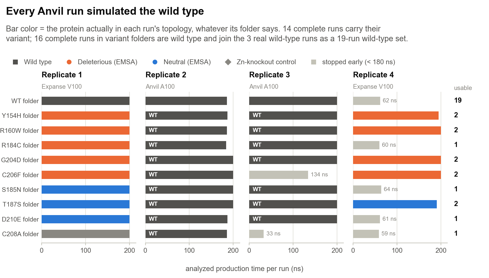
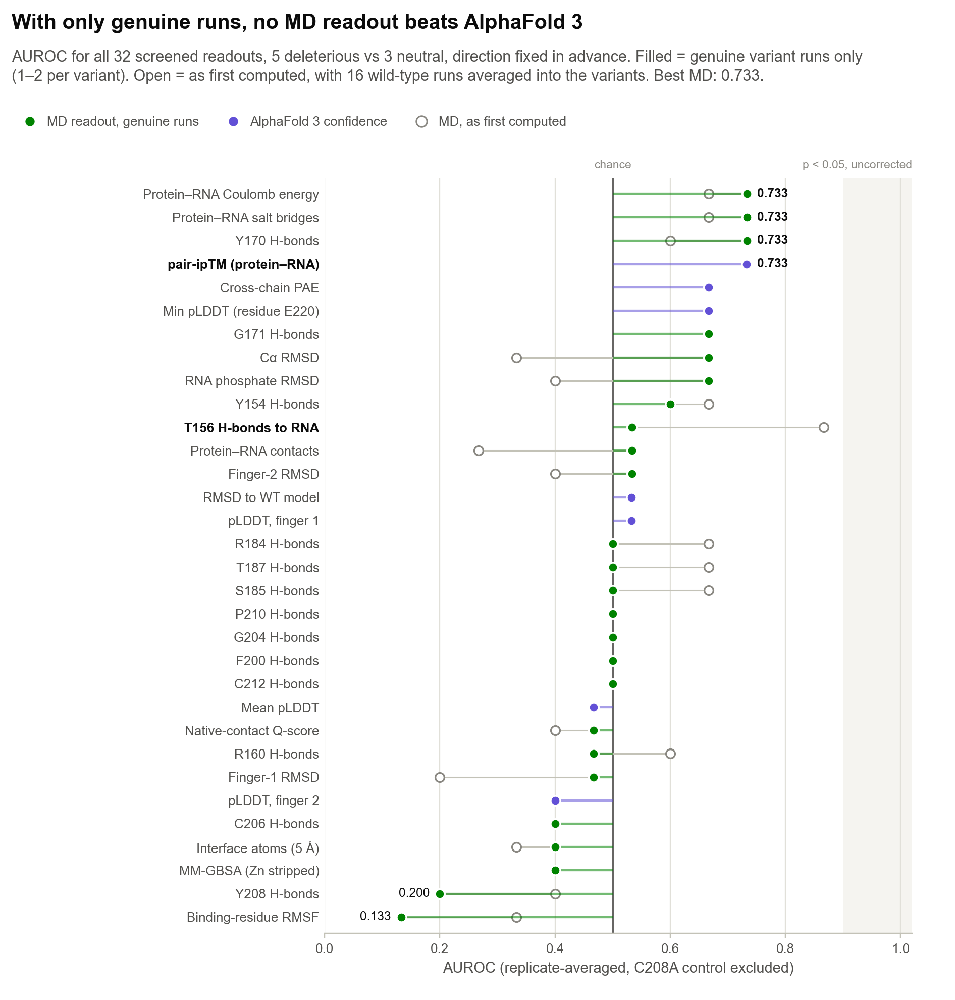
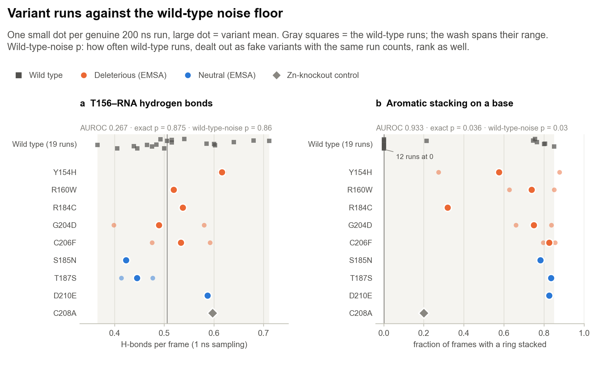

# 2 · Molecular dynamics results

[← AlphaFold 3 results](01_AF3_results.md) · [Back to overview](../README.md) · [Conclusions →](03_conclusions.md)

AlphaFold 3 returns one static complex per variant. A point mutation that weakens RNA binding might not change that snapshot, but it should change how the complex behaves over time: which contacts hold, which break, how often. That was the bet behind the MD: run every labeled variant long enough, and more than once, to see a difference AF3 cannot. While writing this page I audited what each run had actually simulated, and the answer changed the results. The audit comes first, because everything after it depends on it.

## Protocol

| Step | Setting |
|:--|:--|
| Starting structure | Top-ranked AF3 model per variant (highest ranking score across 8 seeds × 5 models) |
| Engine | OpenMM 8.2 on CUDA (`anvil_md/run_md_anvil.py`) |
| Force field | AMBER ff14SB (protein), RNA.OL3, TIP3P water |
| System | 1.2 nm padding, 0.15 M NaCl; about 23,000–25,000 atoms |
| Zinc | Harmonic Zn–S restraints to each cysteine within 0.35 nm of a Zn²⁺ (k = 200 kJ mol⁻¹ nm⁻², r₀ from the AF3 model); histidine ligands unrestrained |
| Equilibration | Energy minimization; 0.2 ns NVT with heavy-atom restraints (1000 kJ mol⁻¹ nm⁻²); 0.5 ns NPT (100 kJ mol⁻¹ nm⁻²) |
| Production | NPT, 310 K, 1 atm; Langevin integrator (1 ps⁻¹), Monte Carlo barostat; 2 fs step with H-bond constraints; PME, 1.0 nm cutoff; frames every 100 ps |
| Runs | 40 production runs of up to 200 ns: four run sets of ten folders, on SDSC Expanse (V100) and Purdue Anvil (A100); runs of at least 180 ns count as complete |

## What was actually simulated

  

I read every run's own topology (`equilibrated.pdb`) and compared its protein sequence with the construct (`figures/src/audit_md_runs.py`, output in `figures/data/md_run_inventory.csv`).

- **All 20 Anvil runs contain the wild-type protein**, including the 18 in variant folders. Every Expanse run carries its folder's mutation.
- **The RNA (UUAUUUAUU) and both Zn²⁺ are present in all 40 runs.** Only the protein is wrong.
- **This is what was simulated, not a labeling slip.** Each Anvil trajectory has exactly the atom count of its wild-type topology, and its first frame sits within 0.6–2.6 Å Cα RMSD of it.
- **Likely cause.** `anvil_md/anvil_replica_job.sh` looks for `${VARIANT}_cleaned.pdb`, but `clean_af3_structures.py` writes `<input name>_cleaned.pdb` (for example `Y154H_best_model_cleaned.pdb`). When the expected file is missing, the script falls back to `find … -name "*cleaned.pdb" -newer <input> | head -1`, which can return another variant's file. All 20 Anvil structures sit closest to the WT input model (0.5–0.7 Å), consistent with the WT file being picked each time. The margin is small, because the AF3 models of all variants lie within about 1 Å of each other.
- **The fix, for anyone re-running.** Derive the cleaned filename from the input, drop the fallback, and check each topology's sequence before production; `audit_md_runs.py` does that check.

What remains:

| | Complete runs | Sampling |
|:--|--:|--:|
| Genuine runs of the eight labeled variants (one or two each) | 13 | 2.6 µs |
| Genuine run of the C208A control | 1 | 0.2 µs |
| Wild-type set: 3 WT-folder runs + 16 misfiled runs | 19 | 3.7 µs |

Every earlier MD summary in `expanse_md_analysis/` averaged the misfiled runs into the variants. That includes `FINAL_SUMMARY.md`, the standardized T156 re-analysis, and the stacking and mechanism checks. The numbers on this page use genuine runs only. The wild-type set has a use of its own: 19 runs of the same protein from nearly the same start show how much one trajectory varies with no mutation at all.

## How readouts are scored

- **AUROC** is the probability that a randomly chosen deleterious variant looks more damaged than a randomly chosen neutral one. 0.5 is chance and 1.0 is perfect separation.
- **Direction is fixed in advance.** For example, fewer RNA hydrogen bonds counts as more damaged. Values below 0.5 mean the readout leaned the wrong way; I did not flip them.
- **Genuine runs are averaged** per variant before scoring, so each variant contributes one number.
- **Five deleterious against three neutral** variants gives 15 pairs, so AUROC moves in steps of 1/15. P-values are exact one-sided Mann–Whitney tests over the 56 possible rankings.
- **Wild-type-noise test.** I deal the 19 wild-type runs out at random as fake variants, with each variant's real run count, and record how often they rank at least as well as the real variants. This asks whether an AUROC exceeds what run-to-run noise alone produces.
- **The C208A zinc-knockout control is not scored.** It removes a zinc ligand by design and is not one of the EMSA-labeled variants.

## The corrected screen

  

- **No MD readout beats AF3.** Protein–RNA Coulomb energy, salt bridges and Y170 hydrogen bonds reach 0.733, tying AF3's pair-ipTM. That corresponds to p = 0.196, well short of significance.
- **T156 hydrogen bonds fall from 0.867 to 0.533** once the misfiled runs are removed. This is the readout earlier summaries called the best MD feature.
- **Many readouts moved by 0.2–0.3** between the mixed and the genuine data. Cα RMSD went from 0.333 to 0.667, and contacts from 0.267 to 0.533. With one or two runs per variant, single trajectories decide these values.
- **MM-GBSA with zinc stripped is not physical.** Removing the zinc to fit a standard implicit-solvent model gives positive interaction energies around +12,000 kJ/mol and an AUROC of 0.400. A real free-energy estimate needs a bonded zinc model, such as ZAFF or MCPB.py.

## Variants against the wild-type noise floor

  

**a. T156 hydrogen bonds.** T156 is the threonine of the RYKTEL motif that leads into finger 1. In the TIS11d structure, residues of this motif contact the RNA bases (Hudson et al. 2004). The analysis code calls it F156; see the [naming notes](#naming-in-the-analysis-code). With 1 ns sampling the earlier standardized re-analysis gave 0.800 (p = 0.125). On genuine runs it gives **0.267** (wild-type-noise p = 0.86), the wrong direction. The 19 wild-type runs alone span 0.37 to 0.71 H-bonds per frame, and every variant mean falls inside that range. The 0.800 came from averaging wild-type runs into the variants.

**b. Aromatic stacking.** Uracil stacking on aromatic side chains is the textbook way these fingers read RNA. Stacking was scored for all nine aromatic residues and four combined readouts, 13 in all.

On genuine runs the "any aromatic", F176 and finger-1 readouts each reach **0.933** (exact p = 0.036; wild-type-noise p = 0.03). These three readouts are identical in these runs, because F176 is the ring that stacks. Y170 reaches 0.867 and Y208 0.800. The same readouts scored only 0.53 on the mixed data.

It is the strongest MD lead in the project, and it should not be read as a result:

- It rests on two runs: the single R184C run (0.32) and one of the two Y154H runs (0.27). Nearly every other variant run stays stacked.
- It does not survive correction for the 45 readouts tested (Bonferroni bar 0.0011).
- It fails a sanity check. The wild-type protein, which binds RNA normally, stays stacked in only 6 of its 19 runs, less often than most deleterious variants. Whatever this readout tracks here, it is not simply binding competence. Starting structure and register are more likely drivers: the wild-type runs mostly began from one AF3 model, and each variant's runs from its own.

| Variant | Class | Genuine runs | T156 H-bonds | Aromatic stacking |
|:--|:--|--:|--:|--:|
| Y154H | deleterious | 2 | 0.616 | 0.575 |
| R160W | deleterious | 2 | 0.519 | 0.738 |
| R184C | deleterious | 1 | 0.537 | 0.318 |
| G204D | deleterious | 2 | 0.489 | 0.748 |
| C206F | deleterious | 2 | 0.533 | 0.826 |
| S185N | neutral | 1 | 0.423 | 0.781 |
| T187S | neutral | 2 | 0.445 | 0.834 |
| D210E | neutral | 1 | 0.587 | 0.826 |
| C208A | control | 1 | 0.597 | 0.199 |
| wild-type set | reference | 19 | 0.524 | 0.260 |

## Earlier analyses that relied on the misfiled runs

- **The mechanism decomposition is moot.** The search for a mechanism behind the T156 signal (which base T156 reads, propagation through the RYKTEL region, stacking "ruled out") was done on the mixed data. With the signal gone on genuine runs, there is nothing left for it to explain.
- **The single-run window comparisons still stand.** The first 139 and 269 ns of the first Expanse runs were genuine, and they reappear in [Conclusions](03_conclusions.md#reasonable-analysis-choices-move-the-answer).

## Caveats

- **One or two genuine runs per variant.** Single trajectories decide most variant means here, and the wild-type set shows how far one run can wander.
- **Short equilibration and production.** Equilibration was 0.7 ns of restrained dynamics, and the first 50 ns of production are partly relaxation from the AF3 pose. Akçeşme et al. used 3 × 1 µs runs (GROMACS, AMBER99SB) started from homology models.
- **Zinc is restrained, not modeled.** Zn–Cys harmonic restraints keep the fingers intact, but they cannot describe how a mutation strains zinc coordination. This matters most for C206F and the C208A control.
- **Four trajectories start late.** For four Expanse runs (WT, Y154H, R184C, C208A), a restart without `--resume` overwrote the first ~130 ns of the trajectory file. The checkpoints reached 400 ns, and the analyzed 200 ns for these runs begin about 130 ns into the simulation.
- **A 9-nt RNA is short.** It can sit on the protein in more than one register, which inflates differences between runs.

## Naming in the analysis code

The per-residue hydrogen-bond columns in `expanse_md_analysis/` were named from a residue list that does not match the construct sequence at six positions. The data are computed at the right positions; only the labels are wrong. I checked every MD topology, and the figures use the residue that is actually there.

| Column in the analysis CSVs | Construct position | Actual residue |
|:--|--:|:--|
| `hbond_RNA_F156` | 6 | **T156** (RYKTEL) |
| `hbond_RNA_H170` | 20 | Y170 |
| `hbond_RNA_R171` | 21 | G171 |
| `hbond_RNA_R200` | 50 | F200 |
| `hbond_RNA_C208` | 58 | Y208 |
| `hbond_RNA_D210` | 60 | P210 |

The variant called C212A in the MD code is the C208A control, and the D210E construct carries D219E (see [AF3 results](01_AF3_results.md#inputs)).

## Files

| Path | Contents |
|:--|:--|
| `figures/src/audit_md_runs.py`, `figures/data/md_run_inventory.csv` | What each run simulated: protein sequence, RNA, zinc, closest input model |
| `anvil_md/run_md_anvil.py` | Production driver: solvation, restraints, equilibration, checkpointed production |
| `anvil_md/clean_af3_structures.py`, `select_best_models.py` | AF3 → MD structure preparation and model selection |
| `anvil_md/anvil_replica_job.sh` | Anvil replica job, including the filename fallback described above |
| `anvil_md/*.sh`, `anvil_md/expanse/` | SLURM submission scripts for Anvil and Expanse |
| `expanse_md_analysis/multi_replicate_auroc_v2.py` | Per-run readouts for the screen (`multi_replicate_all_metrics.csv`) |
| `expanse_md_analysis/diagnostic_f156_convergence.py` | T156 at 1 ns sampling (`diagnostic_f156_convergence.csv`) |
| `expanse_md_analysis/compute_stacking_metrics.py`, `stacking_geometry.py` | Aromatic stacking geometry (tested by `test_stacking_geometry.py`) |
| `expanse_md_analysis/compute_mmgbsa_qscore.py` | Q-score and the zinc-stripped MM-GBSA |

The per-run CSVs carry a `source` column, which `make_figures.py` joins to the audit to keep only genuine runs. The Markdown notes in `expanse_md_analysis/`, such as `FINAL_SUMMARY.md` and `FINAL_CONCLUSIONS.md`, are dated working notes from before the audit, and their MD numbers include the misfiled runs. This page and [Conclusions](03_conclusions.md) supersede them.

## References

- Eastman P, et al. OpenMM 8: molecular dynamics simulation with machine learning potentials. *J Phys Chem B* 128, 109–116 (2024).
- Maier JA, et al. ff14SB: improving the accuracy of protein side chain and backbone parameters from ff99SB. *J Chem Theory Comput* 11, 3696–3713 (2015).
- Zgarbová M, et al. Refinement of the Cornell et al. nucleic acids force field based on reference quantum chemical calculations of glycosidic torsion profiles. *J Chem Theory Comput* 7, 2886–2902 (2011).
- Jorgensen WL, et al. Comparison of simple potential functions for simulating liquid water. *J Chem Phys* 79, 926–935 (1983).
- McGibbon RT, et al. MDTraj: a modern open library for the analysis of molecular dynamics trajectories. *Biophys J* 109, 1528–1532 (2015).
- Hudson BP, Martinez-Yamout MA, Dyson HJ, Wright PE. Recognition of the mRNA AU-rich element by the zinc finger domain of TIS11d. *Nat Struct Mol Biol* 11, 257–264 (2004).
