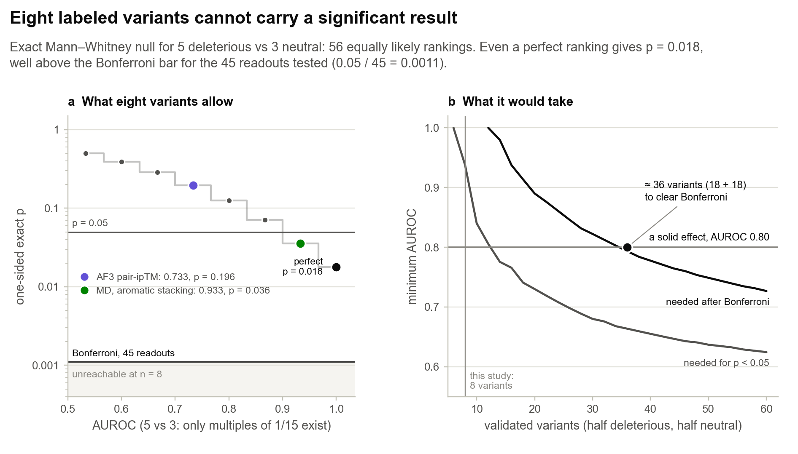
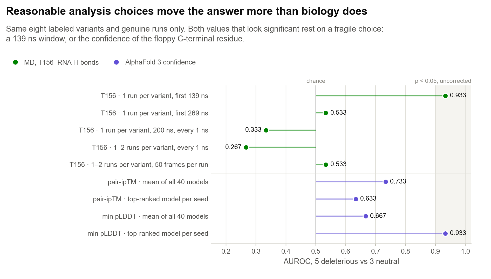

# 3 · Conclusions

[← MD results](02_MD_results.md) · [Back to overview](../README.md)

Structure prediction followed by simulation is often presented as a way to triage variants before anyone runs a gel. This project tested that idea on about as clean a case as exists: one small domain, one RNA, and eight variants whose effects had been measured by EMSA. My answer, for now, is no. AlphaFold 3's confidence barely moves between variants. MD, once the runs are checked for what they actually simulated, does no better: the readout that once looked best was produced by wild-type runs filed as variants, and the strongest remaining lead fails a basic sanity check. Underneath both problems sits a third, which no amount of simulation can fix: eight labeled variants cannot carry a significant result.

## What held up

- **AF3 builds a plausible bound complex for every variant.** Its interface confidence also drops sharply for a non-binding RNA (0.765 → 0.376), so the predictor is sensitive to binding, just not to these point mutations. Its pair-ipTM (AUROC 0.733) is as good as anything the project found.
- **The audit.** Every Anvil run simulated the wild-type protein. Catching this turned 16 misfiled runs into something useful: with the three real wild-type runs they form a 19-run wild-type set. That set shows that one trajectory's T156 hydrogen-bond count can land anywhere from 0.37 to 0.71 with no mutation at all.
- **Negative results that hold on genuine runs.** Bulk RMSD, contact counts and the native-contact Q-score do not separate the classes. MM-GBSA without a zinc model is not physical.

## What did not

- **The T156 signal.** The earlier AUROC of 0.800 (one-sided p = 0.125) falls to 0.267 on genuine runs. It came from averaging wild-type runs into the variants.
- **Significance.** No readout survives correction. Aromatic stacking reaches an uncorrected p of 0.036, but that rests on two runs, and the wild-type protein stacks in only 6 of its 19 runs, less often than most deleterious variants.
- **Stability across analysis choices.** Even on genuine data, defensible alternatives move the T156 AUROC anywhere from 0.27 to 0.93.

## Eight variants cannot carry a significant result

  

Five deleterious and three neutral variants can be ranked in only 56 distinct ways. A perfect ranking is one of them, so its p-value is 1/56 = 0.018. The project tested 45 readouts, which puts the Bonferroni bar at 0.0011. That bar lies below anything eight variants can produce. More replicates, longer trajectories, or a better readout cannot change this arithmetic.

Panel b turns the question around and asks how many validated variants a solid effect, AUROC 0.80, would need:

- **14 variants (7 + 7)** for an uncorrected p < 0.05 on a single readout chosen in advance.
- **About 36 variants (18 + 18)** to survive correction for a 45-readout screen like this one.

## Reasonable analysis choices move the answer

  

Every row of this figure uses the same eight variants, only genuine runs, and a choice I could defend in a methods section.

- **Window length.** The first Expanse run of each variant gives 0.933 over its first 139 ns, 0.533 over 269 ns, and 0.333 over 200 ns at 1 ns sampling. Had I stopped at 139 ns, I would have reported a nominally significant result.
- **Runs and sampling.** Pooling the one or two genuine runs per variant gives 0.267 at 1 ns sampling and 0.533 when each run is sampled at 50 frames.
- **Model pooling in AF3.** Averaging all 40 models gives pair-ipTM 0.733; using each seed's top model gives 0.633. The same switch lifts min pLDDT from 0.667 to 0.933, a number that measures the disordered C-terminal residue.

With only 15 deleterious–neutral pairs, one pair changing order moves the AUROC by 0.067. Analysis choices that look minor can therefore produce, or erase, an apparent result. This is the garden of forking paths in miniature (Gelman and Loken 2014). The honest response is to fix one analysis before looking.

## Why I paused

There is a version of this project that keeps going: re-run the misfiled replicates, add more, test aromatic stacking head-on. I weighed each. Correct replicates would finally give every variant three or four genuine runs, and that is the one step I would take first if the project resumed. Yet even perfect replicates cannot lift the ceiling that eight labels impose, and the stacking lead already contradicts itself on the wild type. To be fair, a null result at n = 8 does not show that MD cannot rank these variants; it shows that this dataset cannot tell either way. That is a reason to stop spending GPU hours on it, not a verdict on the method.

## Lessons

1. **Check what you simulated, not what the folder says.** A one-line filename fallback put the wild-type protein into 16 variant runs, and the project's headline result grew out of them. Reading each topology's sequence takes seconds; it should run before any analysis.
2. **Count labels before nanoseconds.** The number of experimentally validated variants sets the best p-value any method can reach. Check that ceiling before planning simulations.
3. **Fix the analysis before looking.** Choose one primary readout, window, sampling interval and pooling rule in advance, then score it once.
4. **Check residue identities against the sequence on day one.** Six of the fourteen per-residue labels in the analysis code were wrong, and an "F156 aromatic stacking" story turned out to be about a threonine.
5. **Use the wild type as a yardstick.** Many runs of the unmutated protein show how far noise alone can move a readout. Any variant effect has to clear that bar, and a readout on which the wild type looks damaged is measuring something else.
6. **Read AF3 summary metrics before trusting them.** Here "min pLDDT" was the confidence of the last residue in the construct, and the way models were pooled changed which AF3 metric looked best.

## What would justify resuming

- **Re-run the 16 Anvil replicates correctly.** Fix the filename logic in `anvil_replica_job.sh`, audit every topology before production, and start replicates from several AF3 models. Separating starting-structure effects from variant effects needs both.
- **Fix one readout in advance.** Score it once on the corrected runs. Aromatic stacking is the natural candidate, provided the wild type behaves like a binder on it.
- **More EMSA-validated variants.** About 14 balanced variants can test one pre-registered readout; about 36 can support a screen. Labels predicted by other tools would not help, because scoring against another predictor's calls is circular.
- **A bonded zinc model** (ZAFF or MCPB.py), so that binding free energies become meaningful.

Eight labeled variants could not answer the question I asked, but they did show what an answer would cost, and the audit showed what a wrong one looks like. More nanoseconds sharpen each estimate; only correct runs and more labels can make the comparison mean something.

## References

- Akçeşme B, Hekimoğlu H, Chirasani VR, İş Ş, Atmaca HN, Waldern JM, Ramos SBV. Identification of deleterious non-synonymous single nucleotide polymorphisms in the mRNA decay activator ZFP36L2. *RNA Biology* 22(1):1–15 (2025). doi:10.1080/15476286.2024.2437590
- Gelman A, Loken E. The statistical crisis in science. *American Scientist* 102(6), 460–465 (2014).
- Mann HB, Whitney DR. On a test of whether one of two random variables is stochastically larger than the other. *Ann Math Stat* 18, 50–60 (1947).
